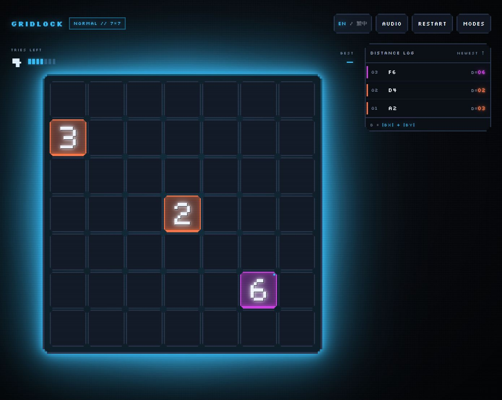

# GRIDLOCK

**A pixel-neon deduction game.** Click a cell, get the Manhattan distance to the hidden target, narrow it down before your tries run out.

**[▶ Play in your browser](https://embarrass9426.github.io/gridlock/)**

No framework, no bundler, no npm install. `index.html`, `styles.css`, and `game.js` are the whole game, and it runs from GitHub Pages or directly from disk.

---

## How to play

1. A target is hidden somewhere on the grid.
2. Click any cell. It shows the **Manhattan distance** from that cell to the target — the number of orthogonal steps, ignoring diagonal moves.
3. Cells are heat-shaded by how close they are. Colder = further.
4. Each wrong guess burns one try. Click the exact cell and you win.
5. Run out of tries and the board locks you out.

`0` means you found it. Everything else is a compass.

## Modes

| Mode | Grid | Tries | Colour |
| --- | --- | --- | --- |
| EASY | 5 × 5 | 8 | green |
| NORMAL | 7 × 7 | 7 | blue |
| HARD | 9 × 9 | 6 | red |
| EXTREME | 11 × 11 | 5 | purple |

Best score per mode is kept in `localStorage`.

## Controls

| Key | Action |
| --- | --- |
| `Arrows` | move the cursor |
| `Enter` / `Space` | guess the focused cell |
| `R` | restart the current mode |
| `M` | toggle sound effects |
| `B` | toggle background music |
| `Esc` | close the info or audio dialog |

Everything is also clickable, and the board is fully keyboard navigable.

## Features

- **Manhattan-distance deduction** with heat shading instead of a direction arrow.
- **Pixel art and neon** throughout — rounded pixel-stepped cells, bitmap wordmark, chunky Silkscreen type.
- **Hand-made VFX** — shockwave rings, particle bursts, pixel shatter on a win, board shake and RGB split on a loss, an illumination wave that sweeps the grid on reveal, staggered cell entry.
- **Synthesised 8-bit SFX** built with the Web Audio API — no audio files for the effects, and the cue changes with how hot the guessed cell is.
- **Looping background tracks**, one per screen, streamed from `assets/music/`. Music ducks under the result dialog and pauses when the tab is hidden.
- **Separate SFX and BGM mixer** — independent mute toggles and 0–100% volume sliders, persisted between visits.
- **English / 繁體中文**, with Traditional Chinese set in a real pixel font (Ark Pixel), not a smooth fallback.
- **Accessible** — live-region announcements, focus trapping in dialogs, and visible focus states.

## Tech notes

- **Rendering:** DOM grid. No canvas, no framework, no bundler. Cells are `<button>`s so focus and screen readers work for free.
- **Digits and the wordmark** are inline SVG 5×7 bitmap glyphs, drawn rather than loaded.
- **Sound:** a small Web Audio engine — three buses, a compressor, and synthesised cues. Background music is streamed as MP3s from `assets/music/`.
- **Type:** [Silkscreen](https://github.com/googlefonts/silkscreen) for Latin, plus a 10 KB subset of [Ark Pixel 12px](https://github.com/TakWolf/ark-pixel-font) (OFL-1.1) embedded for Traditional Chinese. Noto Sans TC is the fallback, never the intent.

## Files

| Path | What it is |
| --- | --- |
| `index.html` | the page markup |
| `styles.css` | all styling, including the pixel/neon shell and board |
| `game.js` | game logic, audio engine, i18n, and VFX |
| `assets/music/*.mp3` | the background tracks, one per screen |
| `assets/preview.jpg` | README screenshot |

Open `index.html` in any modern browser, or push to `main` and let GitHub Pages serve the repo root. There is no build step.

## Licence

Code and art are **MIT** — see [LICENSE](LICENSE). Do what you like with it.

Bundled third-party assets keep their own licences:

- **Ark Pixel Font** — SIL Open Font License 1.1, © TakWolf.
- **Silkscreen** — SIL Open Font License 1.1, © Jason Kottke.
- **Background music** — no-copyright tracks sourced from YouTube. They are third-party material and are **not** covered by this project's MIT licence.
